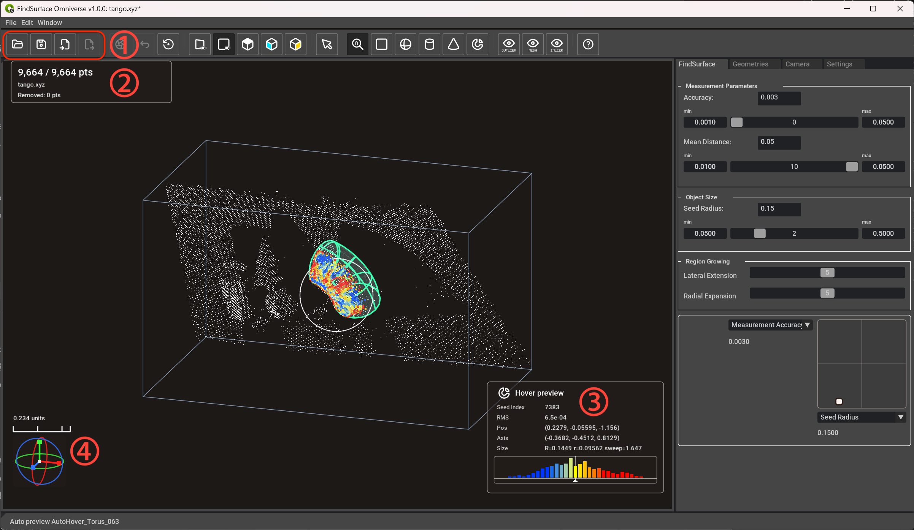
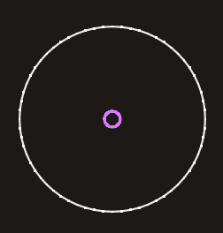
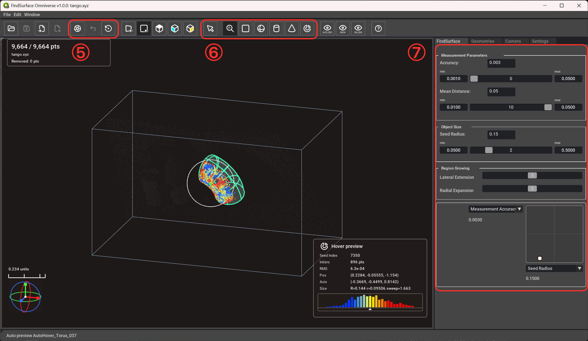
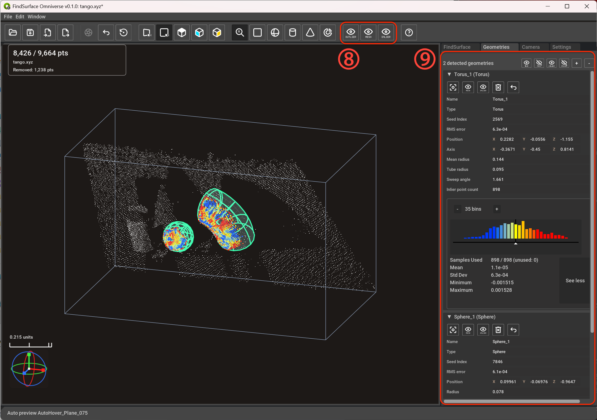
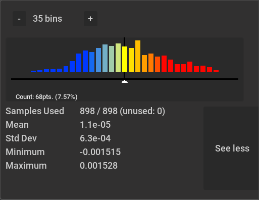
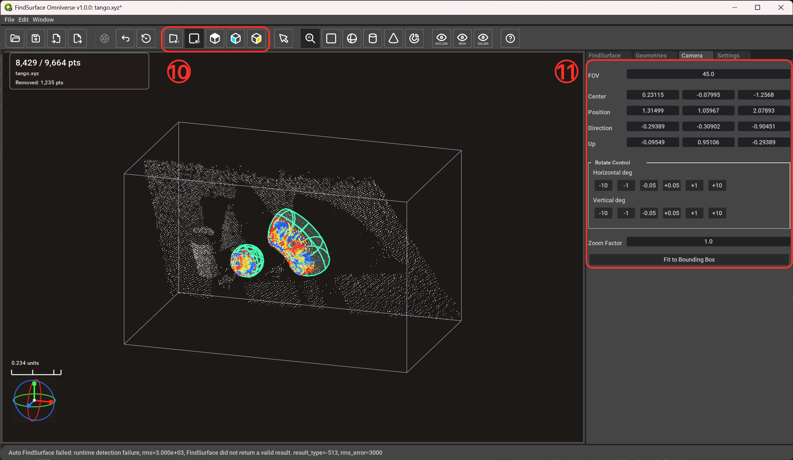
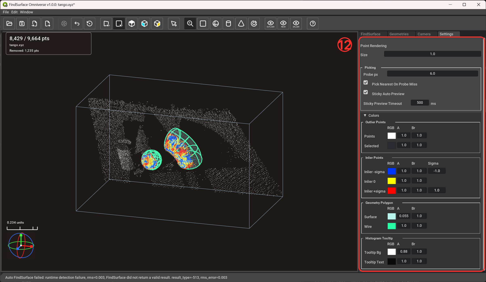
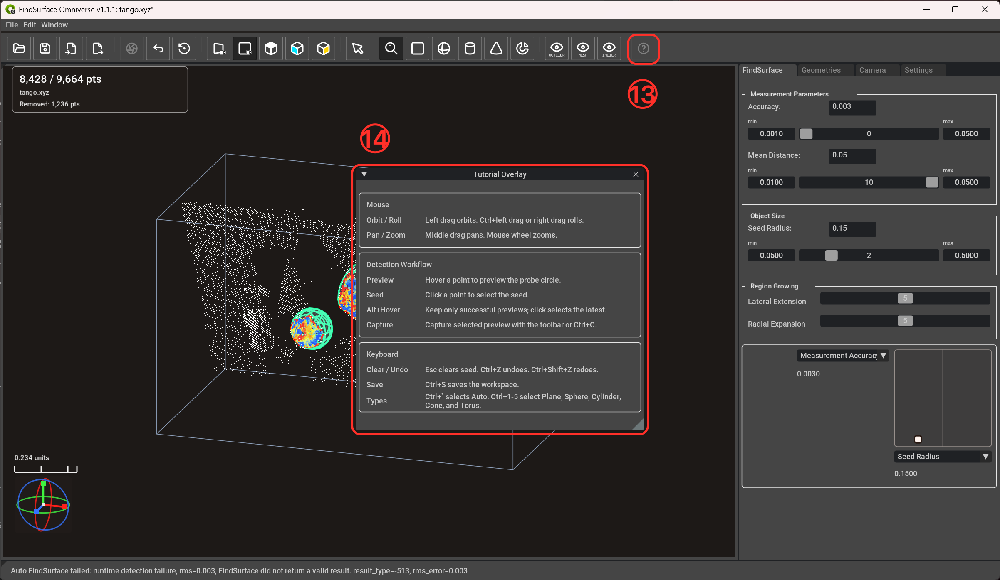

# FindSurface Omniverse Manual

**Curv*Surf* FindSurface™** demo application for detecting analytic geometry
from point clouds inside NVIDIA Omniverse Kit.

[FindSurface](https://github.com/CurvSurf/FindSurface) / [CurvSurf GitHub](https://github.com/CurvSurf)

## Overview

FindSurface Omniverse Demo loads a point cloud, lets the user choose or preview
a seed point in the viewport, runs FindSurface detection, and captures the
detected geometry as editable results. The application is designed as a minimal
Kit workspace: the left side is a viewport for point-cloud inspection, while
the right side contains task panels for detection, captured geometry, camera
control, settings, and state history.

This manual follows the numbered screenshots below. Each red circled number in
a screenshot is explained in the section below that image.

## Basic Usage

1. Launch the app.

   From a source checkout:

   ```powershell
   .\repo.bat build
   .\repo.bat launch
   ```

   `repo launch` opens the main demo app by default. Diagnostic launch targets
   are still kept for validation and troubleshooting, but you only need them
   when you explicitly want to run a debug `.kit` file.

   From an extracted thin release package:

   ```powershell
   .\pull_kit_sdk.bat
   .\com.curvsurf.findsurface_omniverse_demo.kit.bat
   ```

   The legacy launch scripts are still available when you want to run against
   a specific Kit executable:

   ```powershell
   .\tools\launch.ps1 -KitExe "C:\path\to\kit.exe"
   ```

   ```bash
   ./tools/launch.sh --kit-executable /path/to/kit
   ```

2. Import a point-cloud file from the toolbar, or load a saved FindSurface
   workspace. If no previous file location has been saved, Import opens at the
   packaged point-cloud presets folder and Load opens at the packaged workspace
   presets folder.
3. Choose a detection type. `Auto`, `Plane`, `Sphere`, `Cylinder`, `Cone`, and
   `Torus` are supported.
4. Move the cursor over the point cloud. The seed and probe circles show the
   point neighborhood used for preview and picking.
5. Hover over the target point and check whether the preview matches the
   intended analytic surface.
6. Click the point to select it. The seed index is then fixed to the selected
   point, so you can tune parameters manually for that target point without the
   preview moving to another hover index.
7. Capture the previewed geometry.
8. Inspect captured geometry in the `Geometries` tab, adjust visibility, undo or
   redo operations, and export the captured results as USD.

When detection succeeds only intermittently, hold `Alt` while searching with
the cursor. While `Alt` is held, the red hover-point marker advances only when
a hover detection succeeds, preserving the most recent successful seed and
preview when later hover attempts fail. Click while still holding `Alt` to
select that preserved seed and display its successful detection result instead
of recomputing from the point currently under the cursor.

## Supported Input

The point-cloud importer reads XYZ coordinates from:

- `.xyz`, `.pts`, `.ptx`: text rows. The first three numeric columns are read as `x y z`.
- `.obj`: vertex rows beginning with `v`.
- `.ply`: ASCII PLY vertex data.
- `.pcd`: ASCII PCD files with `x`, `y`, and `z` fields.
- `.usd`, `.usda`, `.usdc`: `UsdGeom.Points` prims when USD Python modules are available.

Loading a workspace is different from importing a point cloud. `Load Workspace`
expects a FindSurface workspace file saved by this app; the file contains
FindSurface metadata such as app id, schema version, and `kind = "workspace"`.
`Import Point Cloud` reads point data from supported files, including USD files
created by other tools, and only imports point-cloud geometry from those files.

The default import limit is 200,000 source points. Oversized files can be
rejected or reservoir-sampled to 100,000 points. Binary PLY and binary PCD files
are not supported by the minimal loader. Colors, normals, intensity, and other
attributes are currently ignored.

## User Interface

### Viewport



The viewport shows active outlier points, captured analytic geometry, and
captured inlier points together. Colored inlier points work like a signed
distance-error heat map: points near the fitted surface are shown with the
zero-distance color, while points on the negative and positive sides of the
surface move toward the configured negative and positive colors. The color
scale is normalized by the standard deviation of that geometry's signed inlier
distances, so the colors show relative fit error within each captured result
rather than an absolute world-unit distance.

#### (1) File Toolbar

| Icon | Name | Meaning |
|:----:|:----:|:--------|
|  | Load Workspace | Opens a FindSurface workspace saved by this app. The file must contain the app's workspace metadata, and restores the point cloud, active/removed point state, captured geometries, display state, camera state, and transaction history. |
|  | Save Workspace | Saves the current editable FindSurface workspace. The button is enabled when the current workspace has unsaved changes. |
|  | Import Point Cloud | Imports point-cloud data from a supported point file or from `UsdGeom.Points` prims in USD files created by this or other applications. |
|  | Export As USD | Exports captured analytic geometries, RMS error metadata, optional visualization meshes, and inlier point sets to a USD file. |

#### (2) Top-Left Overlay

The top-left overlay summarizes the loaded point cloud:

- Total number of active points and original source points, shown as `active / total pts`.
- Source filename.
- Number of points removed from the active cloud by captured detections.

#### (3) Bottom-Right Overlay

The bottom-right overlay describes the current hover preview or selected preview:

- `Seed Index`: source point used as the detection seed.
- `RMS`: fitting error of the previewed analytic geometry.
- `Pos`: detected geometry position.
- `Normal` or `Axis`: surface orientation. Planes show `Normal`; cylinders,
  cones, and tori show `Axis`. Spheres do not show an orientation row.
- `Size`: detected type-specific size values, such as radius, tube radius, or sweep angle.
- `Inliers`: number of points accepted as inliers for the preview.
- Histogram graph: compact signed inlier-distance distribution around the
  detected surface. See [Histogram](#histogram) for the detailed Geometries
  window view.

#### (4) Gizmo And Ruler

The orientation gizmo shows the camera direction and can be dragged to adjust
the view. The ruler gives a screen-space scale reference in world units and can
also be dragged to reposition it inside the viewport.

### Cursor



The viewport cursor contains two picking guides:

| Guide | Meaning |
|:-----:|:--------|
| White outer circle | Seed radius. Points inside this world-space neighborhood are used as the seed region for FindSurface preview and detection. |
| Purple inner circle | Probe radius. This screen-space picking radius is used to find the hovered or selected point under the cursor. |

### FindSurface Panel



#### (5) Capture And History Toolbar

| Icon | Name | Meaning |
|:----:|:----:|:--------|
|  | Capture | Captures the current selected preview as a geometry result and removes its inlier points from the active point cloud. The keyboard shortcut is `Ctrl+C` when a preview is capturable. |
|  | Undo | Reverts the latest detection, parameter, visibility, or camera transaction. Redo is available from `Edit > Redo` and the `Ctrl+Shift+Z` shortcut. |
|  | Reset | Resets the detection state and clears captured detection results from the active workflow. |

#### (6) Detection Type Toolbar

| Icon | Name | Meaning |
|:----:|:----:|:--------|
|  | Inspect Geometries | Disables hover preview, point picking, and selected-point detection so existing geometries can be inspected without changing the active preview. |
|  | Auto | Lets FindSurface choose the analytic type that best matches the seed region. Use this first when the target type is unknown. |
|  | Plane | Detects a planar surface from the seed region and grown inliers. |
|  | Sphere | Detects a sphere and reports its center and radius. |
|  | Cylinder | Detects a cylinder and reports its axis and radius. |
|  | Cone | Detects a cone and reports its axis and cone parameters. |
|  | Torus | Detects a torus and reports its axis, mean radius, tube radius, and sweep angle. |

#### (7) Detection Parameters

The `Inspect Geometries` toolbar mode turns off hover preview and point picking.
Choose `Auto`, `Plane`, `Sphere`, `Cylinder`, `Cone`, or `Torus` to resume
detection. While a detection type is selected, moving over active points runs a
hover preview; clicking a point locks the seed and runs a selected preview.

Range-parameter rows use the same layout:

- The value field shows the current actual value and can be edited directly.
- The `min` field sets the lower bound used by the slider.
- The slider changes the value within the current min/max range.
- The `max` field sets the upper bound used by the slider.

Parameter groups:

- `Measurement Parameters`
  - `Measurement Accuracy`: the expected RMS measurement error of the point
    cloud. Use a scanner-provided or heuristic noise estimate; FindSurface uses
    it as a prior error scale when judging whether the fitted surface is
    reliable.
  - `Mean Distance`: the expected average spacing between neighboring points.
    This is usually related to scanner resolution and scan distance, and helps
    FindSurface judge whether the detected inlier region has a plausible point
    density.
- `Object Size`
  - `Seed Radius`: world-space radius around the seed point where FindSurface
    starts searching. Choose it according to the target geometry size: larger
    values provide more local context, while smaller values keep the seed more
    selective.
- `Region Growing`
  - `Lateral Extension`: controls how strongly the search region spreads along
    the tangent direction of the target surface. Higher values can grow larger
    planes or longer cylinders; it does not affect sphere or torus searches.
  - `Radial Expansion`: controls how strongly the search region expands in the
    normal direction of the target surface. Increase it to include more
    thickness/noisier inliers, or reduce it to reject points farther from the
    fitted surface.

These summaries follow the parameter terminology in the
[CurvSurf FindSurface README](https://github.com/CurvSurf/FindSurface#how-does-it-work).
Refer to that page for the original definitions and tuning guidance.

The bottom control is the **Co-tuning Pad**. It is a 2D parameter pad for
changing two parameters at the same time: choose the vertical-axis parameter
from the upper dropdown, choose the horizontal-axis parameter from the lower
dropdown, then drag the handle inside the square. Moving horizontally updates
the lower-axis parameter, moving vertically updates the upper-axis parameter,
and diagonal movement adjusts both together while the viewport preview updates.

### Geometries Panel



#### (8) Global Visibility Toolbar

These toolbar buttons control rendering for the whole viewport.

| Icon | Name | Meaning |
|:----:|:----:|:--------|
|   | Show/Hide outlier points | Enables or disables rendering of outlier points, meaning the active point cloud that has not been captured as inliers. |
|   | Show/Hide all meshes | Globally enables or disables rendering of detected surface meshes in the viewport. |
|   | Show/Hide all inlier points | Globally enables or disables rendering of all captured inlier point sets in the viewport. |

#### (9) Geometries List

The `Geometries` tab lists captured detection results. The header shows the
number of detected geometries and provides batch controls for the geometry
items in the list.

| Icon | Name | Meaning |
|:----:|:----:|:--------|
|   | Show/Hide all meshes | Sets every geometry item's mesh visibility on or off. This is different from the global visibility toolbar: it changes the per-item visibility setting rather than only toggling the viewport render layer. |
|   | Show/Hide all inlier points | Sets every geometry item's inlier-point visibility on or off. This is different from the global visibility toolbar for the same reason. |
| <kbd>+</kbd> <kbd>-</kbd> | Expand/Collapse all items | Expands every geometry item to show details, or collapses every item to save panel space. |

Each geometry item has its own action row:

| Icon | Name | Meaning |
|:----:|:----:|:--------|
|  | Focus | Reframes the viewport camera around this geometry. |
|   | Show/Hide mesh | Shows or hides this geometry's surface mesh. |
|   | Show/Hide inlier points | Shows or hides this geometry's captured inlier points. |
|  | Delete | Deletes this geometry while keeping its inlier points removed from the active point cloud. |
|  | Cancel Detection | Removes this geometry and restores its inlier points to the active point cloud. |

Geometry details include the result name, analytic type, seed index, RMS error,
position, axis when applicable, type-specific dimensions, and inlier point
count. For example, a torus result reports mean radius, tube radius, and sweep
angle; a sphere result reports radius.

### Histogram



The histogram visualizes signed distances from each inlier point to the detected
analytic surface.

- The `-` and `+` buttons decrease or increase the number of histogram bins.
- Blue bars represent negative signed distances, the center region is near
  zero distance, and orange/red bars represent positive signed distances.
- The vertical center marker is the zero-distance reference. The graph range is
  fixed around zero from `-3σ` to `+3σ`, so the zero marker stays centered.
- The `Count` readout below the graph appears only while the pointer is over a
  histogram bar. It shows the number of points in that fixed bin and its
  percentage of all inlier samples.
- `Samples Used` shows how many inlier samples contributed to the histogram and
  how many were unused because they fell outside the `±3σ` graph range.
- `Mean`, `Std Dev`, `Minimum`, and `Maximum` summarize the signed-distance
  distribution numerically.
- `See details` expands these numeric statistics; `See less` collapses them.

### Camera



#### (10) Projection And View Toolbar

| Icon | Name | Meaning |
|:----:|:----:|:--------|
|  | Perspective Projection | Switches the viewport to perspective projection. Perspective is useful when you want depth cues similar to a normal 3D camera. |
|  | Orthographic Projection | Switches the viewport to orthographic projection. Orthographic is useful for measurement-like inspection without perspective distortion. |
|  | Top View | Applies the top camera preset. |
|  | Front View | Applies the front camera preset. |
|  | Side View | Applies the side camera preset. |

#### (11) Camera Panel

The `Camera` tab exposes the current orbit camera numerically:

- `FOV`: perspective field of view, in degrees.
- `Center`: orbit center in world coordinates.
- `Position`: current camera position in world coordinates.
- `Direction`: camera forward vector.
- `Up`: camera up vector.
- `Rotate Control`: small horizontal and vertical rotation steps in degrees.
- `Zoom Factor`: viewport zoom value.
- `Fit to Bounding Box`: reframes the loaded point cloud and captured geometry in the viewport.

### Settings



#### (12) Settings Panel

The `Settings` tab controls viewport drawing, picking behavior, preview behavior,
and display colors.

| Setting | Meaning |
|:--------|:--------|
| `Point Rendering > Size` | Controls point size in the viewport. Increase it for sparse data or high-resolution displays; decrease it when dense clouds look too heavy. |
| `Picking > Probe px` | Sets the screen-space probe radius used to find a point under the cursor. This corresponds to the purple cursor guide. |
| `Pick Nearest On Probe Miss` | When enabled, a probe miss can fall back to the nearest point instead of leaving no pick. |
| `Sticky Auto Preview` | Keeps the last valid auto preview visible briefly when the cursor leaves a valid seed. |
| `Sticky Preview Timeout` | Sets the sticky preview duration in milliseconds. |
| `Outlier Points` | Sets colors, alpha, and brightness for active outlier points and the selected point. |
| `Inlier Points` | Sets the negative, zero, and positive inlier colors used by the viewport and histogram. Sigma values define the signed-distance color scale. |
| `Geometry Polygon` | Sets the detected surface fill and wire colors. |
| `Histogram Tooltip` | Sets tooltip background and text colors for histogram detail display. |

### Sticky Auto Preview

`Sticky Auto Preview` makes hover preview easier to inspect while the cursor is
moving. Hover detection runs asynchronously, and the cursor can briefly leave a
valid seed point between frames or while you move toward the toolbar. With
sticky preview enabled, the last valid preview remains visible for a short time
instead of disappearing immediately.

The preview disappears after the timeout because it is no longer tied to the
current hover seed. This prevents an old detection from looking like a live
preview after the cursor has moved away. In `Settings`, disable `Sticky Auto
Preview` to clear invalid hover previews immediately, or change `Sticky Preview
Timeout` to make the grace period shorter or longer.

### Tutorial



#### (13) Tutorial Button

| Icon | Name | Meaning |
|:----:|:----:|:--------|
|  | Tutorial | Opens the tutorial overlay with mouse controls, detection workflow reminders, and keyboard shortcuts. |

#### (14) Tutorial Overlay

The tutorial overlay is a quick reference that can stay on top of the viewport
while learning the app:

| Group | Action | Meaning |
|:------|:-------|:--------|
| Mouse | Orbit / Roll | Left drag orbits. `Ctrl+left drag` or right drag rolls. |
| Mouse | Pan / Zoom | Middle drag pans. Mouse wheel zooms. |
| Detection Workflow | Preview | Hover a point to preview the probe circle. |
| Detection Workflow | Seed | Click a point to select the seed. |
| Detection Workflow | Alt+Hover | Hold `Alt` while hovering to keep the red marker on the latest successful preview; click while holding `Alt` to select that seed and show its detection result. |
| Detection Workflow | Capture | Capture the selected preview with the toolbar or `Ctrl+C`. |
| Keyboard | Clear / Undo | `Esc` clears the seed, `Ctrl+Z` undoes, and `Ctrl+Shift+Z` redoes. |
| Keyboard | Save | `Ctrl+S` saves the workspace. |
| Keyboard | Types | ``Ctrl+` `` selects `Auto`; `Ctrl+1` through `Ctrl+5` select `Plane`, `Sphere`, `Cylinder`, `Cone`, and `Torus`. |

Use `Alt+Hover` as a conservative selection mode when successful detections
flicker or are easy to pass over. Failed hover attempts do not move the red
marker, so you can stop on and select the last successful result.

## Detection Workflow

1. Import or load point-cloud data.
2. Start with `Auto` detection unless you already know the target surface type.
3. Move the cursor until the hover preview outlines the intended surface.
4. Click the target point to lock the seed index.
5. Tune `Measurement Accuracy`, `Mean Distance`, and `Seed Radius` if the selected preview is too small, too large, or unstable.
6. Use `Lateral Extension` and `Radial Expansion` to control how far the inlier region grows from the seed.
7. Capture the previewed geometry.
8. Review the result in `Geometries`. Delete a wrong result when it should be removed permanently, or cancel it when its inliers should return to the active point cloud.
9. Save the workspace if you want to preserve editable state, or export geometries when you want a USD result for downstream tools.

## Workspace and Export

Use `Save` for editable FindSurface workspaces. A workspace stores the source
points, active mask, captured results, display state, camera state, and undo/redo
transaction history.

Workspace loading accepts FindSurface workspace files saved by this app, not
arbitrary USD point-cloud files. These workspace files are USDA text files with
FindSurface metadata identifying the app id, schema version, and workspace kind.
Use `Import Point Cloud` when you want to read `UsdGeom.Points` from an external
USD file.

Use `Export` for geometry interchange. Geometry exports are USDA files under
`/FindSurfaceExport`, with `findsurface:*` attributes, inlier `Points` prims,
and optional visualization meshes. Workspace loading intentionally rejects
geometry export files so project state and interchange output remain separate.

Each exported geometry includes its detected RMS fitting error as
`findsurface:rms_error`. In reverse-engineering workflows, this value can be
used as a compact uncertainty clue when downstream tools try to reconnect
nearby analytic geometry. For example, a detected cylinder and a torus segment
that represent a pipe and elbow may fail to meet exactly because the scan data
contains measurement noise. A constraint solver can treat a larger RMS value as
evidence that the corresponding fitted geometry may be allowed to move more
while satisfying a connection constraint; when both geometries have very small
RMS values, forcing them to move may be less plausible or may indicate that no
good connection solution exists.

NVIDIA Omniverse provides USD Physics and PhysX workflows for constrained
relationships such as revolute, prismatic, spherical, distance, fixed, and
generic D6 joints. These are physics/assembly constraints rather than a
dedicated reverse-engineering geometry stitching tool, but they illustrate the
same kind of downstream decision point: exported FindSurface RMS values can
help another USD-aware process weight how strongly each detected analytic
primitive should be trusted while solving adjacency or connection constraints.
See NVIDIA's
[Omni PhysX joint documentation](https://docs.omniverse.nvidia.com/kit/docs/omni_physics/latest/dev_guide/rigid_bodies_articulations/joints.html)
for the USD Physics and joint workflow background.

The FindSurface core can also compute richer uncertainty information, including
covariance between detected parameters and per-parameter variance. This
information is not currently exposed through the application or exported USD
schema, so `findsurface:rms_error` is the available uncertainty metric today.

## Notes

- If detection fails repeatedly, increase `Measurement Accuracy` or move the seed probe to a denser, cleaner point region.
- If the preview jumps between nearby objects, reduce `Seed Radius` or disable sticky hover preview in Settings.
- If captured geometry hides too much of the source cloud, use the visibility buttons or the per-result mesh/inlier toggles in `Geometries`.
- If the viewport becomes hard to navigate, use the `Camera` tab's fit command or the toolbar projection buttons to reset orientation and scale.
